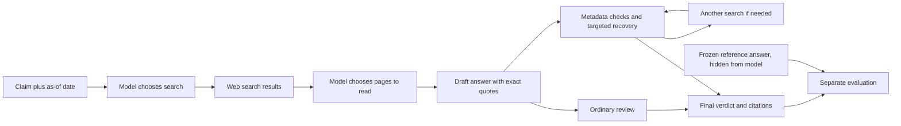

# Dated authority evidence checking

The [completed four-case canary](AUTHORITY_RESULTS.md) found no demonstrated factual-accuracy gain. Its recorded traces are published; the holdout remains unused.

The tested model still finds its own evidence. The new controller checks whether its cited FDA/CDC pages carry matching issuer, date and scope quotations, and gives the treatment a bounded opportunity to repair missing metadata or search for a specific evidence gap.



The reference is the evaluator's answer key. The candidate's evidence comes from pages it searches for and opens. These are deliberately different inputs. A real quotation is not enough: its date, product, population and meaning must support the claim. Mechanical checks establish only some of those properties.

## Data and scope

[40 draft claims](data/authority_v1/manifest.json): 20 development, 20 held out, grouped by 20 document families. Each split has five recent-change, five exact-scope, five outdated/conflicting, and five false-premise/missing-context cases. Eight of 40 concern notices in the preceding 90 days. Twelve reference labels are supported, 24 contradicted, four missing-context insufficient. All are AI-authored stress claims, not extracted videos. References are not human reviewed. A dated-notice question is narrower than current personalized clinical advice.

[Protocol](AUTHORITY_PROTOCOL.md) specifies the canary, budgets, metrics and promotion criteria before inference. The executable checks are in `reelcheck/authority.py`; the historical recovery experiment remains in its original modules.

## Run the development canary

```sh
python3 -m unittest discover -s tests -q
node tests/test_recovery_worker.js
python3 scripts/run_authority.py init --out results/authority-canary-new --canary
python3 scripts/run_authority.py review --out results/authority-canary-new --live
python3 scripts/run_authority.py advance --out results/authority-canary-new --live
```

Between advance passes, run `authorityWebWorker(tools, report, cwd, out)` from `scripts/authority_web_worker.js` in Codex's tool bridge. It executes each model-selected query/read and persists every raw result before ingestion. Wait for each advance command to exit before running the worker. The next advance uses the observations. Repeat until all initial and recovery tasks are terminal; do not repeat a failed model request. The state and prompt/response journals preserve failed attempts. `--live` requires a Fireworks key in the environment, a local ignored `.env`, or a simple export in the configured shell-key file. Never commit credentials.

```sh
python3 scripts/run_authority.py judge --out results/authority-canary-new --live
python3 scripts/run_authority.py report --out results/authority-canary-new
```

Review and grounding are independent capped batches; each refuses to overwrite an existing batch. Default configured limits are $2 candidate reservations and $3 per assessment batch, conservative ceilings rather than invoices. Web-tool charges are unavailable. Full development mode omits `--canary`; held-out inference is deliberately not exposed in this staged runner.

Five development arms compare no-search, ordinary search/retry, authority-aware recovery, stronger open-model reference, and metadata-only enforcement. The last arm helps distinguish routing from mechanical enforcement. All three cheap recovery arms start from the same draft and remaining allowances. Only ordinary versus treatment can support a harness claim; no-search is a diagnostic.

## Interpreting results

A reference-label match is provisional truth scoring. A separate two-judge assessment examines the actual retrieved packet. A failure to retrieve evidence for an answerable claim is an operational abstention, not a correct insufficient answer. Disagreement and failed judgments remain unresolved. The score reports neither clinical safety nor human-verified accuracy. Small canary improvements would not prove aggregate improvement.
